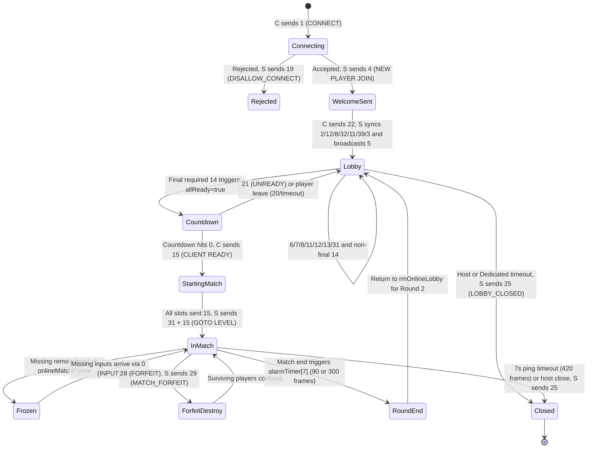
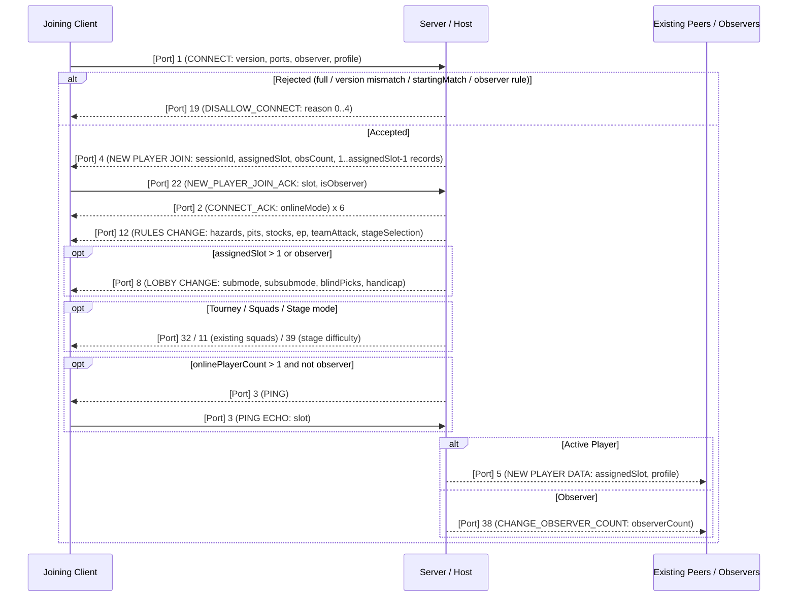

# Mega Man Arena Online Wire Protocol Specification

> **Clean-Room Specification Notice**: This document specifies the wire protocol, framing rules, packet layouts, and state transitions of **Mega Man Arena 5.0** (network version string `"5.0.0.4890"`), along with the **Arena8** (all-mode 8-player + anti-stall deadline timeline, `"5.0.0.4890-arena8-deadline"`) and **DedicatedServer** extensions, derived strictly through clean-room engineering analysis. No game source code is reproduced here.

---

## 1. Protocol Variants & Defaults

| Variant | Default Control Port | Default Input Port (`Port + 1`) | Version String | Max Active Players | Key Protocol Differences |
| --- | :---: | :---: | --- | :---: | --- |
| **Stock 5.0 (4P)** | `6520` | `6521` | `"5.0.0.4890"` | `4` | Hardcoded `sendDataToNewPlayer` `switch (1..5)`; host is slot `1` |
| **DedicatedServer (4P Patch)** | `6520` | `6521` | `"5.0.0.4890"` | `2..4` | Host sets `onlineObserver = true` (occupies no player slot); enforces `(IP, port)` -> `sourceSlot` validation; blocks client-sent host packets `8, 12, 13, 32, 34`; enforces start/inactivity deadlines |
| **Arena8 (All-Mode 8P + Deadline)** | `6528` | `6529` | `"5.0.0.4890-arena8-deadline"` | `8` | Loop-based `sendDataToNewPlayer` (`1..8+`), omits trailing `"NEW PLAYER JOIN"` tag, supports all 6 modes (`Arena8`, `Teams`, `Squads`, `Boss`, `Elevator`, `Stage`), uses Packet `240` (`DEADLINE_TIMELINE`) authoritative 60 Hz frame commit when `onlinePlayerCount > 4` (standard Packet `0` for `2..4` players) |

### 1.1 Slot & List Indexing Rules

- **On-wire player slots (`playerSlot` / `playerPort`)** are **1-based**: `1..N` (`1..4` stock, `1..8` Arena8).
- **On-wire observer slots (`observerSlot` / `observerPort`)** are **1-based**: `1..M`.
- **Internal endpoint lists** (`clientIPList`, `clientPortList`, `clientPortListUDP`, `observerIPList`, `observerPortList`) and per-slot ping arrays (`onlinePingTimer`, `onlineObserverPingTimer`) are **0-based**: index `= slot - 1`.
- **Observer welcome offset**: When an observer joins, the server passes `assignedSlot = onlinePlayerCount + 1` in packet `4` so the observer reads all `1..onlinePlayerCount` existing player records; the observer client derives `onlinePlayerCount = assignedSlot - 1` and sets `onlineObserverPort = observerCount`.
- **Packet `5` (`NEW PLAYER DATA`) slot assignment quirk**: The client overwrites `global.onlinePlayerCount` directly with the incoming `newSlot` byte and writes the record into slot `newSlot`. Servers must therefore assign joining players strictly sequential slots (`1, 2, ..., N`), and must compact slots via packets `9` (`CHANGE_PLAYER_PORT`) and `10` (`CHANGE_PLAYER_DATA`) on departure.

---

## 2. GML Buffer Wire Types & Encoding

All multi-byte numeric fields are **little-endian**. GameMaker's `buffer_write` / `buffer_read` type IDs observed on the wire are:

| GML Constant | Type ID | Wire Size | Encoding & Notes |
| --- | :---: | :---: | --- |
| `buffer_u8` | `1` | 1 byte | Unsigned 8-bit integer (`0..255`) |
| `buffer_s8` | `2` | 1 byte | Signed 8-bit integer (`-128..127`) |
| `buffer_u16` | `3` | 2 bytes | Unsigned 16-bit LE (`0..65535`) |
| `buffer_s16` | `4` | 2 bytes | Signed 16-bit LE (`-32768..32767`) |
| `buffer_u32` | `5` | 4 bytes | Unsigned 32-bit LE |
| `buffer_s32` | `6` | 4 bytes | Signed 32-bit LE |
| `buffer_f16` | `7` | 2 bytes | IEEE 754 half-precision float (unused by online packets) |
| `buffer_f32` | `8` | 4 bytes | IEEE 754 single-precision float (unused by online packets) |
| `buffer_f64` | `9` | 8 bytes | IEEE 754 double-precision float (unused by online packets) |
| `buffer_bool` | `10` | 1 byte | Boolean byte (`0x00` = `false`, `0x01` = `true`; non-zero read as `true`) |
| `buffer_string` | `11` | `len + 1` bytes | UTF-8 string terminated with a single `0x00` NUL byte |
| `buffer_u64` | `12` | 8 bytes | Unsigned 64-bit LE (used for `randomSeed` in packet `15`) |
| `buffer_text` | `13` | `len` bytes | Unterminated UTF-8 text (NOT boolean! Unused in structured packets; conceptually matches raw `"MMA_PING"` probe) |

> **Important Implementation Note on Type IDs `10` vs `13`**: GameMaker assigns `buffer_bool = 10`, `buffer_string = 11`, `buffer_u64 = 12`, and `buffer_text = 13`. Booleans on the wire are type `10` (`buffer_bool`), **not** `13`. Note also that the stock client occasionally writes and reads a 1-byte boolean-like setting (`slideDownJump` or `cheatEnabled`) using `u8` (`1`) on one side and `bool` (`10`) on the other; both are 1 byte (`0x00`/`0x01`) and binary-compatible.

> **Trailing Packet Tag Strings**: Most control-socket senders append a diagnostic `buffer_string` tag (e.g., `"CONNECT"`, `"CONNECT_ACK"`, `"NEW PLAYER JOIN"`). Receivers parse fixed positional fields from offset `0` of the unwrapped GML payload and ignore any unread trailing bytes.

---

## 3. Transport Architecture & Dual-UDP Socket Routing

Each participant operates two UDP sockets:

```
Client                                                Server
  clientSocket    (clientPort, 40006..49999) <======> serverSocket    (Port: 6520 / 6528)
  clientSocketUDP (clientPort + 1)           <======> serverSocketUDP (Port + 1: 6521 / 6529)
```

### 3.1 GM RUDP Framing & `onlineUseInputRUDP`

1. **Control / RUDP Socket (`Port` <-> `clientPort`)**:
   - Both `serverSocket` (`Port`) and `clientSocket` (`clientPort`) enable GameMaker's reliable UDP (`network_config_enable_reliable_udp`). Consequently, **every GameMaker datagram on `Port`** (everything except the out-of-band raw ASCII probe `"MMA_PING"`) is wrapped in a **12-byte GM RUDP transport header**:
     - Bytes `0..3`: `u32 LE` `~Crc32(bytes[4..])` (bitwise NOT of standard IEEE CRC-32 computed over byte `4` through the end of the datagram).
     - Bytes `4..7`: `u32 LE` `kind` (`1` = `DATA`, `2` = `ACK`).
     - Bytes `8..11`: `u32 LE` `seqNum` (1-based monotonic sequence counter shared across **both** `kind = 1` (`DATA`) and `kind = 2` (`ACK`) packets; GM server uses a single socket-wide sequence counter, while GM clients accept gaps and acknowledge exact received `seqNum`s). Because GM peers assign monotonic `seqNum`s to `kind = 2` (`ACK`) frames as well, peers expect inbound `kind = 2` sequence numbers to be acknowledged in later `kind = 2` frames (otherwise GM clients retransmit unacknowledged `kind = 2` datagrams roughly every `3s`).
     - Bytes `12..` when `kind == 1` (`DATA`): the unwrapped **GML application payload** starting with `[u16 sessionId][u8 dataType]...`.
     - Bytes `12..` when `kind == 2` (`ACK`): one or more `u32 LE` acknowledged `seqNum` values (`(len - 12) / 4` entries, batched periodically ~every `1s`). Note that real GM ACK datagrams can exceed `62` entries (live captures observe up to `64` entries / `268` bytes and `68` entries / `284` bytes), so receivers must accept any valid `u32 LE` entry count (`len >= 16` and `(len - 12) % 4 == 0`) rather than imposing a fixed `62`-entry cap.
   - **Session ID validation**: Inside `kind == 1` (`DATA`), the unwrapped GML payload begins with `[u16 sessionId][u8 dataType]`. Receivers check `header.sessionId == local.onlineSessionID` on all packets **except** packets `1` (`CONNECT`), `4` (`NEW PLAYER JOIN`), and `19` (`DISALLOW_CONNECT`). Packets with a mismatched `sessionId` are discarded.
2. **Input UDP Socket (`Port + 1` <-> `clientPortUDP`)**:
   - Bound on the server when `onlineUseInputRUDP == false` (and bound on clients during join setup on `clientPort + 1`), **without** `network_config_enable_reliable_udp`.
   - Datagrams on `Port + 1` carry **no 12-byte GM RUDP header** and **omit `u16 sessionId`**, starting directly at UDP offset `0` with `[u8 dataType]`.
3. **Input Packet (`dataType = 0`) Mode Selection**:
   - Stock `globalSetDefaultOptions` sets `onlineUseInputRUDP = true`.
   - When `onlineUseInputRUDP == true`: Packet `0` is sent via `clientSocket` -> server `Port` (`clientPort` <-> `Port`) **wrapped in GM RUDP (`kind = 1`)** with `[u16 sessionId][u8 0]...`.
   - When `onlineUseInputRUDP == false`: Packet `0` is sent via `clientSocketUDP` -> server `Port + 1` (`clientPortUDP` <-> `Port + 1`) as raw UDP **without** GM RUDP or `u16 sessionId` (`[u8 0]...`).
   - **Interoperability guidance for servers**: Bind **both** `Port` and `Port + 1`. On `Port`, handle raw ASCII `"MMA_PING"` first, then decode GM RUDP frames (`~Crc32` verification, `kind = 1` DATA dispatch + deduplication, `kind = 2` ACK handling/retransmission, acknowledging both inbound `kind = 1` and `kind = 2` `seqNum`s to prevent 3s client retransmits, and accepting arbitrary valid `u32 LE` ACK lists); on `Port + 1`, accept raw `[u8 dataType]...`. When relaying packet `0`, match each peer's transport mode (`clientPort` wrapped in RUDP with `u16 sessionId` vs `clientPortUDP` raw without `u16 sessionId`).

### 3.2 Endpoint Resolution & Anti-Spoofing (`DedicatedServer`)

- **Stock behavior**: Only treats `sourceIP == "127.0.0.1"` specially (reading `connectingPort` from payload on localhost), which causes multi-client localhost collisions if clients do not bind distinct ports.
- **DedicatedServer hardening**:
  1. Ignores payload `connectingPort` for routing and records the actual UDP source `(async_load["ip"], async_load["port"])` directly into `(clientIPList, clientPortList)` on `CONNECT` (`1`).
  2. Resolves `sourceSlot` (`1..N`) on every incoming datagram by matching `(sourceIP, sourcePort)` against registered `(clientIPList, clientPortList)` (for control socket) or `(clientIPList, clientPortListUDP)` (for input UDP socket).
  3. Rejects packets `0, 3, 6, 7, 11, 14, 15, 20, 21, 23, 24, 27, 28, 31` if the payload `playerSlot != sourceSlot`.
  4. Rejects client-sent host-only administrative packets: `8` (`LOBBY CHANGE`), `12` (`RULES CHANGE`), `13` (`BUFFER`), `32` (`TOURNEY_MATCH_RULES`), and `34` (`TOURNEY_STRIKE`).
  5. Enforces full-lobby readiness (`onlinePlayerCount == onlineLobbySize`) and distinct team colors (`color div 3` in Teams mode) before allowing packet `14` (`PLAYER READY`) to trigger match launch.

### 3.3 Out-of-Band Health Probe (`Port`, `Mma.Server` Contract)

As an extension defined by the **`Mma.Server` headless server contract** (not implemented in stock 5.0 or `DedicatedServer/Patch.csx`), before checking binary packet lengths/headers on the control socket (`Port`), the server checks for exact ASCII/UTF-8 text:

- **Request (`C -> S`)**: `"MMA_PING"` (8 bytes, raw UTF-8, no `sessionId`, no NUL terminator required).
- **Response (`S -> C`)**: `"MMA_PONG:<Mode>:<MaxPlayers>"` (e.g., `"MMA_PONG:Arena:4"`).

---

## 4. Complete Packet ID Table (`0..39`)

Packets on the Control socket (`Port`) travel inside GM RUDP `kind = 1` (`DATA`, after the 12-byte RUDP header) and carry `[u16 sessionId][u8 dataType]` at the start of the GML payload, whereas packets marked **No header (`Port + 1`)** travel as raw UDP without the 12-byte RUDP header or `u16 sessionId`. Optional/diagnostic trailing `string` tags are noted in brackets.

| ID | Name | Socket | Dir | Session Check | Payload Layout (after `[u8 dataType]`) & Semantics |
| :---: | --- | --- | :---: | :---: | --- |
| `0` | `INPUT` | `Port` or `Port+1` | `C->S`, `S->C` | RUDP: Yes; `Port+1`: None | **Asymmetric C->S vs S->C!** See [Section 5](#5-packet-0-lockstep-input-framing--bitmask). |
| `1` | `CONNECT` | `Port` | `C->S` | **Exempt** | `str version`, `u32 clientPort`, `u32 clientPortUDP`, `bool isObserver`, `str name`, `str cloudPlayerId`, `s16 character`, `u8 color`, `u32 primaryColor`, `u32 secondaryColor`, `u8 skin`, `str stageArena`, `str stageBoss`, `str stageStageMode`, `u8 slideDownJump`, `bool isCheatActive`, [`str "CONNECT"`] |
| `2` | `CONNECT_ACK` | `Port` | `S->C` | Yes | `u16 onlineMode`, [`str "CONNECT_ACK"`]. Sent 6× by host on packet `22`. Values: `810`=Arena/Teams, `811`=Teams log label *(stock client `CONNECT_ACK` only logs `811`; Teams `submode=2` arrives via packet `8`)*, `812`=Squads, `813`=Boss, `8002`=Elevator, `823`=Stage, `844`=Tourney (`onlineTournamentMode=true`, sets `onlineMode=810`). |
| `3` | `PING` | `Port` | `S->C`, `C->S` | Yes | `S->C`: [`str "PING"`].<br>`C->S`: `u8 playerSlot`, [`str "PING ECHO"`]. Measures half-RTT in **milliseconds** (`current_time`): `round((current_time - onlinePingStartTimes[slot - 1]) / 2)`. |
| `4` | `NEW PLAYER JOIN` | `Port` | `S->C` | **Exempt** | `u16 assignedSessionId`, `u8 assignedSlot`, `u8 observerCount`, followed by `(assignedSlot - 1)` player records. **Differs between Stock 4P and Arena8 8P!** See [Section 6](#6-stock-4p-vs-arena8-8p-welcome-packet-datatype--4). |
| `5` | `NEW PLAYER DATA` | `Port` | `S->C` | Yes | `u8 newSlot`, `str name`, `s16 character`, `u8 color`, `u32 primaryColor`, `u32 secondaryColor`, `u8 skin`, `str stage`, `bool ready` (`false`), `u8 slideDownJump`, `bool cheatEnabled`, [`str "NEW PLAYER DATA"`]. Note: client sets `onlinePlayerCount = newSlot`. |
| `6` | `CHAR CHANGE` | `Port` | `C->S`, `S->C` | Yes | `u8 playerSlot`, `s16 character`, `u8 color`, `u32 primaryColor`, `u32 secondaryColor`, `u8 skin`, `u8 slideDownJump`, [`str "CHAR CHANGE"`]. |
| `7` | `STAGE CHANGE` | `Port` | `C->S`, `S->C` | Yes | `u8 playerSlot`, `str stage`, [`str "STAGE CHANGE"`]. |
| `8` | `LOBBY CHANGE` | `Port` | `C->S`, `S->C` | Yes | `u8 submode`, `u8 subsubmode`, `bool blindPicks`, `bool handicapEnabled`, [`str` label on initial join]. `DedicatedServer` blocks `C->S`.<br>`submode`: `1`=Squads (`subsubmode=1` Squad Teams), `2`=Teams, `3`=Arena, `8`=Elevator, `11`=Stage, `12`=Boss. |
| `9` | `CHANGE_PLAYER_PORT` | `Port` | `S->C` | Yes | `u8 newPlayerSlot`, `u8 newPlayerCount`, [`str "CHANGE_PLAYER_PORT"`]. Reassigns surviving clients after a player leaves (`onlineRemovePlayer`). |
| `10` | `CHANGE_PLAYER_DATA` | `Port` | `S->C` | Yes | `u8 targetSlot`, `str name`, `s16 character`, `u8 color`, `u32 primaryColor`, `u32 secondaryColor`, `u8 skin`, `str stage`, `bool ready`, `u8/bool slideDownJump`, `u8 handicapStock`, `u8 handicapHealth`, `bool cheatEnabled`, [`str "CHANGE_PLAYER_DATA"`]. |
| `11` | `SQUAD LIST` | `Port` | `C->S`, `S->C` | Yes | `u8 listSize`, `u8 playerSlot`, `u8 charColor`, `u8 slideDownJump`, then `listSize × u16 charMacro` (if empty squad on client, sends `listSize=1`, `charMacro=9999`). No trailing string tag. |
| `12` | `RULES CHANGE` | `Port` | `C->S`, `S->C` | Yes | `bool hazardsOn`, `bool pitsSpikes`, `u8 stockCount`, `u8 epOption` (`0..3`), `bool teamAttack`, `u16 stageSelection` (`839..844`), [`str` label]. `DedicatedServer` blocks `C->S`. |
| `13` | `BUFFER` | `Port` | `C->S`, `S->C` | Yes | `u8 onlineBuffer`, [`str "BUFFER"`]. `DedicatedServer` blocks `C->S`. |
| `14` | `PLAYER READY` | `Port` | `C->S`, `S->C` | Yes | `C->S`: `u8 playerSlot`, [`str` label].<br>`S->C`: `bool allReady`, `u8 playerSlot`, `s16 character`, `u8 color`, `u8 skin`, `str stage`, [`str "PLAYER READY"`]. When `allReady == true`, clients immediately reply with packet `15` (`CLIENT READY`). |
| `15` | `GOTO LEVEL` | `Port` | `C->S`, `S->C` | Yes | `C->S` (`"CLIENT READY"`): `u8 playerSlot`, `str stageChoice`, [`str "CLIENT READY"`].<br>`S->C` (`"GOTO LEVEL"`): `str stageToGoTo`, `u64 randomSeed`, `u8 onlineBuffer`, `bool isHazards`, `bool isPitSpikeHazards`, `u8 stockCount`, `bool isTeamAttackOn`, [`str "GOTO LEVEL"`]. |
| `16` | *Reserved / Unused* | — | — | — | Absent in decompiled online scripts (`UnknownEnum.Value_16` does not exist). |
| `17` | `PORTDISC` | `Port+1` | `C->S` | **No header** | `u8 playerSlot`. NAT port discovery probe (`objGMPunchClient`); updates `clientPortListUDP` and replies with `18`. |
| `18` | `PORTDISC_STOP` | `Port+1` | `S->C` | **No header** | *(Empty payload after `u8 18`)*. Stops client port-discovery loop. |
| `19` | `DISALLOW_CONNECT` | `Port` | `S->C` | **Exempt** | `u8 reason`, [`str "DISALLOW_CONNECT"`]. Reasons: `0`=Lobby full, `1`=Version mismatch, `2`=Match starting, `3`=Observers disabled, `4`=Observer max reached. |
| `20` | `DISCONNECT` | `Port` | `C->S` | Yes | `u8 playerSlot`, [`str`]. Clean leave; triggers `onlineRemovePlayer(playerSlot)`. |
| `21` | `PLAYER UNREADY` | `Port` | `C->S`, `S->C` | Yes | `u8 playerSlot`, [`str`]. Cancels countdown if active (`objOnlineLobbyCountdown`) and clears ready state. |
| `22` | `NEW_PLAYER_JOIN_ACK` | `Port` | `C->S` | Yes | `u8 slot`, `bool isObserver`, [`str "NEW_PLAYER_JOIN_ACK"`]. Triggers host initial sync (`6×2`, `12`, `8`, `32`/`11`/`39`, `3`, and broadcast `5` for active players). |
| `23` | `GRATUITOUS_PING` | `Port` | `C->S`, `S->C` | Yes | `S->C`: [`str "GRATUITOUS_PING"`].<br>`C->S`: `u8 playerSlot`, [`str "GRATUITOUS_PING"`]. Sent at timer frames `180` and `300`. |
| `24` | `GRATUITOUS_PING_ECHO` | `Port` | `C->S`, `S->C` | Yes | `S->C`: [`str "GRATUITOUS_PING_ECHO"`].<br>`C->S`: `u8 playerSlot`, [`str` label]. Resets keepalive timer. |
| `25` | `LOBBY_CLOSED` | `Port` | `S->C` | Yes | [`str "LOBBY_CLOSED"`]. Server/host closed lobby or evicted all players. |
| `26` | `INPUT PING` | `Port+1` | `C->S`, `S->C` | **No header** | [`str` label]. Sent on `Port+1` when `!onlineUseInputRUDP`; registers/updates client's `clientPortListUDP[slot]` from `async_load["port"]`. |
| `27` | `SQUAD_RESEND` | `Port` | `C->S` | Yes | `u8 requesterSlot`, `u8 targetSquadSlot`, [`str "SQUAD_RESEND"`]. Requests server to resend slot `targetSquadSlot`'s packet `11`. |
| `28` | `FORFEIT` | `Port` | `C->S` | Yes | `u8 playerSlot`, [`str`]. Player initiated match forfeit; server computes `forfeitFrame = onlineMatchFrame + onlineBuffer + 2` and broadcasts `29`. |
| `29` | `MATCH_FORFEIT` | `Port` | `S->C` | Yes | `u8 playerSlot`, `u32 forfeitFrame`, [`str "MATCH_FORFEIT"`]. Peers destroy forfeited player once `onlineMatchFrame >= forfeitFrame` and not respawning. |
| `30` | `BOOT_PLAYER` | `Port` | `S->C` | Yes | [`str "BOOT_PLAYER"`]. Sent to kicked/timed-out player before slot eviction. |
| `31` | `HANDICAP` | `Port` | `C->S`, `S->C` | Yes | `u8 playerSlot`, `u8 handicapStock`, `u8 handicapHealth`, [`str`]. Also broadcast for every `1..onlinePlayerCount` immediately before `15` (`GOTO LEVEL`). |
| `32` | `TOURNEY_MATCH_RULES` | `Port` | `C->S`, `S->C` | Yes | `u8 bestOf`, `u8 banCount`, [`str`]. `DedicatedServer` blocks `C->S`. |
| `33` | `TOURNEY_STRIKE_START` | `Port` | `S->C` | Yes | `u8 playerChoosing`, [`str "PLAYER READY"`]. Starts tournament stage-striking turn. |
| `34` | `TOURNEY_STRIKE` | `Port` | `C->S`, `S->C` | Yes | `u8 stageStrikeID`, [`str`]. `DedicatedServer` blocks `C->S`. |
| `35` | `TOURNEY_TIMER` | `Port` | `S->C` | Yes | `u16 tourneyTimer`, [`str "TOURNEY TIMER"`]. Sent every 30 frames (`% 30 == 0`) to P2 (`clientIPList[1]`). |
| `36` | `OBSERVER_PING` | `Port` | `C->S` | Yes | `u8 observerSlot` (1-based), [`str "OBSERVER_PING"`]. Sent every 60 frames by observers. |
| `37` | `OBSERVER_DISCONNECT` | `Port` | `C->S` | Yes | `u8 observerSlot` (1-based). Clean observer exit (`onlineRemoveObserver`). |
| `38` | `CHANGE_OBSERVER_COUNT` | `Port` | `S->C` | Yes | `u8 observerCount`, [`str "CHANGE_OBSERVER_COUNT"`]. Broadcast when observer joins or leaves. *(Stock bug: server's observer-notify loop uses index `i - 1` starting from `i = 0`.)* |
| `39` | `CHANGE_STAGE_DIFFICULTY` | `Port` | `S->C` | Yes | `u8 enemyDamage`, `u8 bossArmor`, `u8 stockReduction`, `bool removeBlueFlags`, `bool removeDrops`, `bool spikeInstakill`, `bool increasedEnemies`, `bool teamAttack`, [`str "CHANGE_STAGE_DIFFICULTY"`]. |
| `240` | `DEADLINE_TIMELINE` | `Port` | `C->S`, `S->C` | Yes | **Arena8 Deadline extension (`> 4` active players)**: `u32 token`, `u16 phase`, `u32 ackOrHighest`, `u8 count`, followed by `count × (frame, bitmask[s])`. See Section 7.4.1 below. |

---

## 5. Packet `0` (`INPUT`): Lockstep Input Framing & Bitmask

Packet `0` is the **only packet whose payload layout differs between `C -> S` and `S -> C`** and whose header varies with `onlineUseInputRUDP`.

### 5.1 Wire Layout

In RUDP mode (`onlineUseInputRUDP == true`), the **12-byte GM RUDP header** (`~Crc32`, `kind = 1`, `seqNum`) precedes offset `0` of the GML payload table below. In Input UDP mode (`onlineUseInputRUDP == false`), there is **no** 12-byte RUDP header and the datagram starts directly at GML offset `0` (`dataType`).

#### Client -> Server (`sendInputs("server")`)

| GML Payload Offset (RUDP / `Port+1`) | Type | Field | Notes |
| :---: | :---: | --- | --- |
| `0` / *(omitted)* | `u16` | `sessionId` | Present **only** if `onlineUseInputRUDP == true` (UDP offset `12` after RUDP header) |
| `2` / `0` | `u8` | `dataType` | Always `0` |
| `3` / `1` | `u8` | `listSize` | Number of `(frameId, bitmask)` entries in this packet (default redundancy `onlineInputSendCount = 2` frames) |
| `4` / `2` | `u8` | `playerSlot` | 1-based sender slot (`1..N`) |
| **`5` / `3`** | **`u32`** | **`clientMatchFrame`** | **Present ONLY in `C -> S`!** Sender's current `onlineMatchFrame`, used by server for per-frame deduplication |
| `9` / `7` | `u32[]` | `entries[listSize]` | Repeated `listSize` times: `[u32 frameId][u32 inputBitmask]` |

#### Server -> Client (`sendInputs("client")`)

| GML Payload Offset (RUDP / `Port+1`) | Type | Field | Notes |
| :---: | :---: | --- | --- |
| `0` / *(omitted)* | `u16` | `sessionId` | Present **only** if relaying over RUDP (`onlineUseInputRUDP == true`; UDP offset `12`) |
| `2` / `0` | `u8` | `dataType` | Always `0` |
| `3` / `1` | `u8` | `listSize` | Number of `(frameId, bitmask)` entries |
| `4` / `2` | `u8` | `sourcePlayerSlot` | 1-based originating player slot (`1..N`) |
| *(omitted)* | — | — | **`clientMatchFrame` is NOT sent in `S -> C`!** |
| `5` / `3` | `u32[]` | `entries[listSize]` | Repeated `listSize` times: `[u32 frameId][u32 inputBitmask]` |

### 5.2 Server Processing & Relay Rules

1. **Deduplication (`"server"` mode)**: Server checks `<playerSlot>_<clientMatchFrame>` against its tracked frame map (`onlineInputsFrame`). If already received, the duplicate packet is ignored; otherwise it is recorded and parsed. (`S -> C` relays from a dedicated server / host can safely emit one relay packet per unique newly-received input or pack recent unconfirmed frames.)
2. **Relay fanout**: Server forwards the input packet (`dataType = 0`, **omitting `clientMatchFrame`**) to every **other** active client (`slot != sourcePlayerSlot`) and to all connected observers.
3. **Dedicated server observer behavior**: Because a `DedicatedServer` runs with `onlineObserver = true` and `startingMatch` transitions into `gotoLevel`, it acts purely as an authoritative relay (it does not generate player inputs for itself).

### 5.3 Input Bitmask Layout (`u32`)

`getInputsBitmask` packs 12 digital inputs twice into a 32-bit unsigned integer (1 bit per action); `readInputsBitmask` reads bits `31..20`:

| Bit (Primary) | Bit (Mirror) | Input Action |
| :---: | :---: | --- |
| `31` | `19` | Left |
| `30` | `18` | Right |
| `29` | `17` | Up |
| `28` | `16` | Down |
| `27` | `15` | Jump |
| `26` | `14` | Shoot |
| `25` | `13` | Shoot Special 1 (`ShootS1`) |
| `24` | `12` | Shoot Special 2 (`ShootS2`) |
| `23` | `11` | Slide |
| `22` | `10` | Item |
| `21` | `9` | Select |
| `20` | `8` | Pause |
| `7..0` | — | Unused (`0`) |

### 5.4 Lockstep Window & Confirmation

- **Delay calculation**: `rollbackWindow = onlineBuffer` (default `5`), `onlineTotalDelay = onlineBuffer + rollbackWindow + 1` (default `11`, though `receiveInputsFromClient` checks `keepWindow = (onlineBuffer * 2) + 2` or `onlineBuffer + rollbackWindow + 2`).
- **Acceptance window**: Incoming `(frameId, bitmask)` entries outside `[onlineMatchFrame - keepWindow .. onlineMatchFrame + 1000]` are discarded.
- **Confirmation**: Each `(frameId, bitmask)` stored for `sourcePlayerSlot` marks `onlineInputConfirm[sourcePlayerSlot]` if not previously present, or flags rollback/resimulation if `rollbackEnabled` and an earlier predicted input differs.

---

## 6. Stock 4P vs `Arena8` 8P Welcome Packet (`dataType = 4`)

Packet `4` (`NEW PLAYER JOIN`) is sent once to a newly accepted client or observer in response to packet `1` (`CONNECT`).

### 6.1 Common Prefix & Per-Player Record

1. **GML Payload Header + Fixed Welcome Fields** *(carried inside GM RUDP `kind = 1`)*:
   - `u16 sessionId` (GML payload header)
   - `u8 dataType = 4`
   - `u16 assignedSessionId` (echoed `onlineSessionID`)
   - `u8 assignedSlot` (`arg2`: `1..N` for active players; `onlinePlayerCount + 1` for observers)
   - `u8 observerCount` (`arg3`: current `onlineObserverCount`)
2. **Repeated `(assignedSlot - 1)` Player Records** (for `rosterSlot = 1` through `assignedSlot - 1`):
   - `str name`
   - `s16 character`
   - `u8 color`
   - `u32 customPrimaryColor`
   - `u32 customSecondaryColor`
   - `u8 skin`
   - `str stage`
   - `bool lobbyReady` (`type 10`)
   - `u8 slideDownJump` (`type 1`)
   - `bool cheatEnabled` (`type 10` on wire; note client `case 4` reads this 1-byte flag via `buffer_u8`)

### 6.2 Exact Structural Differences (`sendDataToNewPlayer.gml` vs `Arena8/Patch.csx` lines 52–76)

| Aspect | Stock 4P (`sendDataToNewPlayer.gml`) | `Arena8` 8P (`Arena8/Patch.csx` lines 52–76) |
| --- | --- | --- |
| **Dispatch Mechanism** | Hardcoded `switch (arg2)` handling ONLY `1, 2, 3, 4, 5` (0–4 existing players). If `arg2 >= 6` (e.g., 5th–8th player, or observer when `onlinePlayerCount >= 5`), **nothing is sent**! | Generic `for (rosterSlot = 1; rosterSlot < arg2; rosterSlot++)` loop supporting arbitrary slot counts (`1..8` players, `9`+ for observers). |
| **Buffer Construction** | Calls `sendDataToClientUDP(...)` with variable argument arrays per `switch` branch. | Manually allocates `buffer_create(256, buffer_grow, 1)` and writes `[u16 sessionId][u8 4][u16 sessionId][u8 arg2][u8 arg3]` + loop records, then calls `network_send_udp`. |
| **Trailing Packet Tag** | Appends `str "NEW PLAYER JOIN"` (`buffer_string`, 16 bytes including NUL) after the last player record. | **Omits** the trailing `"NEW PLAYER JOIN"` `buffer_string` completely! |
| **Client Compatibility** | Stock client `case 4` stops reading right after the `(assignedSlot - 1)` loop and discards unread trailing bytes — so **both** stock and `Arena8` clients parse `Arena8`'s packet `4` identically (up to their max player array bounds: stock arrays overflow at `> 4` without the `Arena8` patch). | Same wire parsing as stock; `Arena8` expands client arrays to 8 slots, guards ping alarms `2..4` safely when `playerSlot > 4`, and sets `teamNumber[slot] = slot`. |

---

## 7. Complete Session Lifecycle & State Machines

### 7.1 High-Level Connection, Lobby, Match & Round 2 Lifecycle



### 7.2 Handshake & Initial Sync Sequence



### 7.3 Lobby -> Countdown -> `GOTO LEVEL` (`15`) Stage Resolution

1. **Ready & Countdown (`14`)**:
   - Client sends `14` (`playerSlot`). Server checks lobby constraints (in `DedicatedServer`: `onlinePlayerCount == onlineLobbySize`, squad length `== stockCount` in Squads, distinct `color div 3` in Teams, `colorTracker` uniqueness otherwise), sets `onlineLobbyReady[slot] = true`, computes `allReady`, and broadcasts `14` (`allReady`, `slot`, `character`, `color`, `skin`, `stage`).
   - If `allReady == false`, clients update lobby UI. If `allReady == true`, clients spawn `objOnlineLobbyCountdown` (or in `DedicatedServer` / stock, host triggers countdown / ready state) and clients transition into sending `15` (`CLIENT READY`: `slot`, `stageChoice`). Note: `objOnlineLobbyCountdown` counts `3 -> 2 -> 1 -> 0` using 60 steps per tick (40 steps on `0`), resets `onlineLobbyReady` flags (`1..4` stock, `1..8` Arena8), plays chime, and allows `startingMatch` launch.
   - `DedicatedServer` enforces a **10,000 ms (`global.mmaDedicatedDeadline`)** cap once `startingMatch = true`; if not all players send `15` in time, it closes the lobby cleanly (`25` `LOBBY_CLOSED`).
2. **Host `GOTO LEVEL` (`15`) Dispatch**:
   - Once all expected `1..onlinePlayerCount` players have sent `15` (`CLIENT READY`), the host/server sets `gotoLevelPacketSent = true`, sends packet `31` (`HANDICAP`) for each `1..onlinePlayerCount`, generates a 64-bit `randomSeed` (`u64`), resolves `stageToGoTo`, and broadcasts `15` (`GOTO LEVEL`):
     - `stageToGoTo`: selected stage string (determined by `onlineStageSelection` `839..844` — random/chosen/counterpick/tourney — or `global.mmaDedicatedStage` on `DedicatedServer`, e.g., `rmWilyBoss`, `rmMechaDragon`, `rmElevator`, `rmBombmanStageMode0`).
     - `randomSeed` (`u64`): shared RNG seed (`random_set_seed(randomSeed)`).
     - `onlineBuffer` (`u8`), `isHazards` (`bool`), `isPitSpikeHazards` (`bool`), `stockCount` (`u8`), `isTeamAttackOn` (`bool`).
   - Clients call `gotoStage`, move into the target room, and enter lockstep match execution.

### 7.4 In-Match Lockstep Relay & Freeze Recovery

- **Per-frame lockstep**: Every step (`objMatchControl_Step_0`), the local client samples inputs via `getOnlineInputs`, tags them for buffered execution, transmits `dataType = 0` carrying up to `onlineInputSendCount` (`2`) redundant recent frames (`C -> S`), and advances `onlineMatchFrame` only when `hasCurrentInput(slot)` confirms inputs are available for **all active players** at execution frame `(onlineMatchFrame - onlineBuffer) + 1` (checked once `onlineMatchFrame > onlineBuffer`).
- **`onlineFreezeWithoutLockin` semantics (`default = true`)**:
  - When `onlineFreezeWithoutLockin == true`, `hasCurrentInput(slot)` requires any remote slot (`slot != localPlayerSlot`) to also have `(onlineMatchFrame - onlineBuffer) + 1` present in `onlineInputConfirm[slot]`; otherwise it flags `rollbackInputUnconfirmed[slot] = true` and returns `false` (freezing until lock-in confirmation arrives).
  - When `onlineFreezeWithoutLockin == false`, any buffered entry in `onlineInputs[slot]` matching `(onlineMatchFrame - onlineBuffer) + 1` satisfies `hasCurrentInput(slot)` without `onlineInputConfirm` lock-in verification.
- **Freeze recovery (`onlineHandleFreeze`, `sendInputsWhenFrozen`)**:
  - When rollback is disabled (or `onlineCanAdvanceFrame == false`) and any player fails `hasCurrentInput(slot)` with `onlineMatchFrame > onlineBuffer`, `onlineHandleFreeze` sets `paused = true`, `frozen = true`, and `onlineCanAdvanceFrameAtEnd = false`, stalling simulation at the current frame.
  - While stalled, `sendInputsWhenFrozen` delegates to `sendInputs("server", localPlayerSlot)` (alongside normal per-step `sendInputs` transmissions) so lost UDP frames can recover via redundant input retransmission. *(Note: `sendEmptyInputs` exists as an unreferenced helper in the exported online scripts with no callers.)*
  - Once missing frame packets arrive via `0` (`INPUT`) and pass `hasCurrentInput`, simulation resumes deterministically.

#### 7.4.1 Deadline Authoritative Timeline (`DataType = 240`, Arena8 `> 4` Players)

When an `Arena8` match launches with more than `4` active players (`5..8`), clients and servers switch from Packet `0` lockstep to **Packet `240` (`DEADLINE_TIMELINE`)** over the Control RUDP socket (`Port`) so a single lagging player never freezes the rest of the match:

- **Shared 14-byte header**: `[u16 sessionId][u8 240][u32 token][u16 phase][u32 ackOrHighest][u8 count]`, where `token = randomSeed % 2^32` and `phase` starts at `1` (incremented to `2`, etc., when transitioning into boss rooms such as Stage mode's boss phase).
- **Client -> Server Proposals (`14 + count × 8` bytes, `count <= 16`)**: Carries `ackFrame = contiguousLocalFrame`, followed by `count × (u32 frame, u32 inputBitmask)` sampled `max(3, ceil(buffer / 2))` frames ahead and uploaded every `12ms`.
- **Server -> Client Authoritative Batches (`14 + count × (4 + playerCount × 4)` bytes, `count <= 20`)**: Server commits frames at `60 Hz` up to `confirmLead = max(2, ceil(buffer / 3))` frames ahead; any player whose proposal missed the deadline receives neutral `0` (`0x00000000`). Broadcasts the latest `<= 8` frames (`200ms` heartbeat when idle) plus targeted `<= 20`-frame catch-up repair batches (`[ackFrame + 1 .. recent - 1]`) for recovering peers (retaining retired phase history for `18s`). Lagging clients automatically run at `1.5×` speed (`game_set_speed`) until queued frames drain cleanly.

### 7.5 Keepalives, Disconnects, Forfeits & Natural Round End (`Round 2`)

1. **Keepalive & Timeout (60 fps frame timers)**:
   - On the server (`onlinePingTimer[slot-1]`) and on non-host lobby clients (`pingTimer`, incremented only when `(onlinePlayerPort > 1 || onlineObserver) && instance_exists(objOnlineLobby)`), per-frame counters increment until reset by peer traffic.
   - Because `onlinePlayerPort == 1` assumes host role in stock P2P and does **not** proactively initiate `23` (`GRATUITOUS_PING`) in the lobby, dedicated servers rely on server-initiated `23` probes; any non-host client (`!onlineIsHost`, including P1 on a dedicated server) replies `24` (`GRATUITOUS_PING_ECHO`) ONLY when `!instance_exists(objMatchControl) || winnerDecided`.
   - At **`180` frames (3s)** and **`300` frames (5s)**: sender emits `23` (`GRATUITOUS_PING`); eligible peer responds with `24` (`GRATUITOUS_PING_ECHO`).
   - At **`420` frames (7s)**:
     - Server evicts the timed-out player via `onlineRemovePlayer(slot)`.
     - Client (when `!onlineTournamentComplete`) treats the host as disconnected and cleans up.
   - `DedicatedServer` also runs a **15,000 ms (`global.mmaDedicatedActivity`)** inactivity watchdog during `startingMatch` / matches and triggers `onlineRemovePlayer(0)` -> broadcasts `25` (`LOBBY_CLOSED`) + `["LOBBY_CLOSED"]` and resets the server room back to lobby.
2. **Disconnect (`20`) & Slot Compaction (`9`, `10`, `30`)**:
   - When a player disconnects cleanly (`20`) or times out (`420` frames), `onlineRemovePlayer(slot)`:
     - If `slot == 0` (host/server closing), broadcasts `25` (`LOBBY_CLOSED`) to all players and observers.
     - Otherwise removes `slot`, shifts higher slots down (`slot+1 .. N`), sends `9` (`CHANGE_PLAYER_PORT`) and updated `10` (`CHANGE_PLAYER_DATA`) records to surviving peers and observers, or sends `30` (`BOOT_PLAYER`) when kicking.
3. **Forfeit (`28` -> `29`)**:
   - In-match forfeit sends `28` (`FORFEIT`, `playerSlot`).
   - Server computes `forfeitFrame = onlineMatchFrame + onlineBuffer + 2` and broadcasts `29` (`MATCH_FORFEIT`: `playerSlot`, `forfeitFrame`).
   - Once `onlineMatchFrame >= playerForfeitedFrame[p]` (and target is not mid-respawn), each client destroys that player's actor cleanly so the match continues deterministically (or ends if 1 contender/team remains). *(Note: in Squad Team tag/co-op modes `subsubmode == 2 || 3`, P1 forfeit sets `onlineHostForfeited = true`.)*
4. **Natural Round End & Return to Lobby for Round 2 (`objMatchControl_Other_17` / `objMatchControlBoss_Other_17`)**:
   - When a match finishes naturally (last player/team standing or boss/stage objective complete), match control schedules end-of-match timers (`alarmTimer[7]` set to `90` or `300` frames depending on end/results state).
   - When `alarmTimer[7]` fires (`Other_17`), **clients remain connected to the same session (`onlineSessionID`) and keep their assigned slots**, transitioning via `room_goto(rmOnlineLobby)`.
   - `objOnlineLobby_Create_0` clears match input buffers (`onlineInputs`, `onlineInputConfirm`), resets `onlineForfeitFrame[p] = 0`, displays the post-match victory overlay (`onlineLobbyVictory`) while temporarily setting `canUseMenu = false`, clears `onlineLobbyReady` (`1..4` stock, `1..8` Arena8), and re-enables `canUseMenu = true` in the lobby so players can start **Round 2**.
