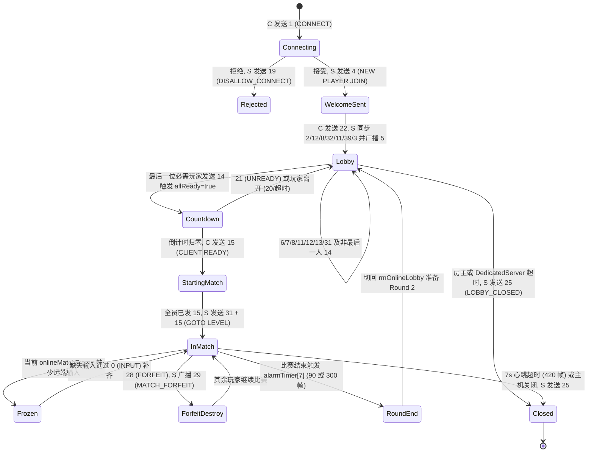
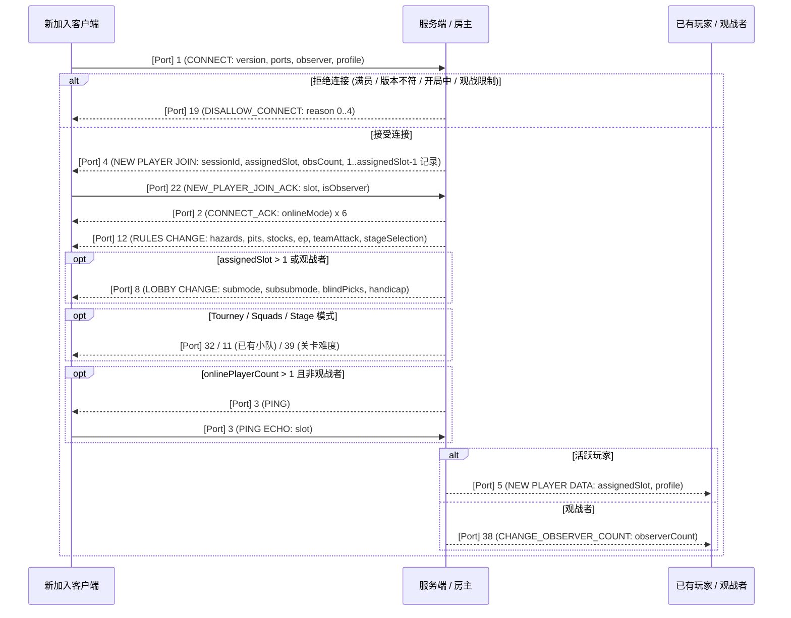

# Mega Man Arena 联机线缆协议规范

> **净室规范说明**：本文档通过净室工程分析整理 **Mega Man Arena 5.0**（网络协议版本字符串 `"5.0.0.4890"`）及其 **Arena8**（8 人补丁，`"5.0.0.4890-arena8"`）与 **DedicatedServer**（独立服务器补丁）的线缆传输格式、分包规则、数据包结构与状态机。文档严格遵守净室原则，不包含任何反编译原始代码。

---

## 1. 协议变体与默认配置

| 协议变体 | 默认控制端口 (`Port`) | 默认输入端口 (`Port + 1`) | 版本字符串 | 最大活跃玩家数 | 核心差异 |
| --- | :---: | :---: | --- | :---: | --- |
| **原版 5.0 (4P)** | `6520` | `6521` | `"5.0.0.4890"` | `4` | `sendDataToNewPlayer` 硬编码 `switch (1..5)`；房主固定占用 `1` 号槽位 |
| **DedicatedServer (4P 补丁)** | `6520` | `6521` | `"5.0.0.4890"` | `2..4` | 服务端设 `onlineObserver = true`（不占玩家槽位）；校验 `(IP, port)` -> `sourceSlot`；屏蔽客户端伪造包及主机专属管理包 `8, 12, 13, 32, 34`；强制开局与活跃超时限制 |
| **Arena8 (8P 补丁)** | `6528` | `6529` | `"5.0.0.4890-arena8"` | `8` | 改用循环版 `sendDataToNewPlayer`（支持 `1..8+`），省略末尾 `"NEW PLAYER JOIN"` 标签；人数 `> 4` 时禁用录像；预设 `teamNumber[slot] = slot` |

### 1.1 槽位与列表索引规则

- **线上玩家槽位（`playerSlot` / `playerPort`）** 严格采用 **1-based**：`1..N`（原版 `1..4`，Arena8 `1..8`）。
- **线上观战者槽位（`observerSlot` / `observerPort`）** 同样为 **1-based**：`1..M`。
- **内部端点列表**（`clientIPList`、`clientPortList`、`clientPortListUDP`、`observerIPList`、`observerPortList`）及延迟计时数组（`onlinePingTimer`、`onlineObserverPingTimer`）采用 **0-based**：索引 `= slot - 1`。
- **观战者欢迎偏移**：观战者加入时，服务端在 `4` 号包中下发 `assignedSlot = onlinePlayerCount + 1`，使循环 `1..(assignedSlot - 1)` 恰好下发全部现有玩家记录；观战端接收后反推 `onlinePlayerCount = assignedSlot - 1`，并设置 `onlineObserverPort = observerCount`。
- **`5` 号包（`NEW PLAYER DATA`）覆盖人数特性**：客户端收到 `5` 号包后会直接执行 `onlinePlayerCount = newSlot` 并写入槽位 `newSlot`。因此服务端必须按 `1, 2, ..., N` 严格顺序分配玩家槽位，并在玩家离开时通过 `9`（`CHANGE_PLAYER_PORT`）与 `10`（`CHANGE_PLAYER_DATA`）紧缩槽位。

---

## 2. GML 缓冲区类型 ID 与编码格式

所有多字节整型均采用 **小端序（Little-Endian）**。GameMaker `buffer_write` / `buffer_read` 的线缆类型编号如下：

| GML 常量 | 类型 ID | 字节长度 | 编码说明 |
| --- | :---: | :---: | --- |
| `buffer_u8` | `1` | 1 字节 | 无符号 8 位整数（`0..255`） |
| `buffer_s8` | `2` | 1 字节 | 有符号 8 位整数（`-128..127`） |
| `buffer_u16` | `3` | 2 字节 | 无符号 16 位小端整数（`0..65535`） |
| `buffer_s16` | `4` | 2 字节 | 有符号 16 位小端整数（`-32768..32767`） |
| `buffer_u32` | `5` | 4 字节 | 无符号 32 位小端整数 |
| `buffer_s32` | `6` | 4 字节 | 有符号 32 位小端整数 |
| `buffer_f16` | `7` | 2 字节 | IEEE 754 半精度浮点（联机协议未使用） |
| `buffer_f32` | `8` | 4 字节 | IEEE 754 单精度浮点（联机协议未使用） |
| `buffer_f64` | `9` | 8 字节 | IEEE 754 双精度浮点（联机协议未使用） |
| `buffer_bool` | `10` | 1 字节 | 布尔值（`0x00` = `false`，`0x01` = `true`；非零均判为 `true`） |
| `buffer_string` | `11` | `len + 1` 字节 | UTF-8 字符串 + 单个 `0x00` 结尾 |
| `buffer_u64` | `12` | 8 字节 | 无符号 64 位小端整数（用于 `15` 号包 `randomSeed`） |
| `buffer_text` | `13` | `len` 字节 | 无 `0x00` 结尾的纯 UTF-8 文本（**并非布尔类型**；结构化包未使用，概念上对应 `"MMA_PING"` 原始探测文本） |

> **关键实现注意（类型 ID `10` 与 `13`）**：GameMaker 中布尔类型是 **`10`（`buffer_bool`）**，而不是 `13`（`buffer_text`）。此外，原版客户端在极少数 1 字节开关字段（如 `slideDownJump` 或 `cheatEnabled`）上存在一端用 `u8 (1)`、另一端用 `bool (10)` 的情况；由于两者均为 1 字节（`0x00`/`0x01`），在线缆上二进制完全兼容。

> **末尾诊断标签字符串**：多数控制包在发送端末尾会附加一个 `buffer_string` 诊断标签（如 `"CONNECT"`、`"NEW PLAYER JOIN"`）。接收端从解包后的 GML 载荷偏移 `0` 按固定字段顺序读取后即结束解析，末尾未读出的字节会被自动丢弃。

---

## 3. 传输架构与双 UDP 端口路由

每个参与节点同时使用两个 UDP 端口：

```
客户端                                                 服务端
  clientSocket    (clientPort, 40006..49999) <======> serverSocket    (Port: 6520 / 6528)
  clientSocketUDP (clientPort + 1)           <======> serverSocketUDP (Port + 1: 6521 / 6529)
```

### 3.1 GM RUDP 封装格式与 `onlineUseInputRUDP`

1. **控制 / RUDP 通道（`Port` <-> `clientPort`）**：
   - `serverSocket`（`Port`）与 `clientSocket`（`clientPort`）均启用了 GameMaker 可靠 UDP（`network_config_enable_reliable_udp`）。因此，**控制端口 `Port` 上的每一个 GM 二进制数据报**（除带外纯文本探活 `"MMA_PING"` 外）外层都包裹着 **12 字节 GM RUDP 传输头**：
     - 字节 `0..3`：`u32 LE` `~Crc32(bytes[4..])`（从第 `4` 字节至报文末尾计算的标准 IEEE CRC-32 按位取反）。
     - 字节 `4..7`：`u32 LE` `kind`（`1` = `DATA` 数据包，`2` = `ACK` 确认包）。
     - 字节 `8..11`：`u32 LE` `seqNum`（1-based 单调递增序号，**同时用于 `kind = 1`（`DATA`）与 `kind = 2`（`ACK`）报文**；GM 服务端在整条套接字上使用单一递增序号，GM 客户端允许序号跳号并精确确认已收到的 `seqNum`）。由于 GM 对端同样会为 `kind = 2` 分配递增 `seqNum`，对端也期待入站 `kind = 2` 的序号在后续 `kind = 2` 报文中被确认（否则 GM 客户端约每 `3s` 重传未确认的 `kind = 2` 报文）。
     - 字节 `12..`（当 `kind == 1` `DATA` 时）：解包后的 **GML 应用层载荷**，以 `[u16 sessionId][u8 dataType]...` 起始。
     - 字节 `12..`（当 `kind == 2` `ACK` 时）：一个或多个 `u32 LE` 已确认的 `seqNum` 列表（通常约每 `1s` 批量发送）。需注意实际 GM 客户端与 `DedicatedServer` 的 ACK 载荷可超过 `62` 条（实测抓包包含 `64` 条 / `268` 字节与 `68` 条 / `284` 字节的 ACK 数据报），因此接收端必须按数据报长度接收任意合法数量（`len >= 16` 且 `(len - 12) % 4 == 0`），切勿硬性限制上限为 `62` 条。
   - **会话 ID 校验**：在 `kind == 1`（`DATA`）解包后的 GML 应用载荷中，前 3 字节为 `[u16 sessionId][u8 dataType]`。除 `1`（`CONNECT`）、`4`（`NEW PLAYER JOIN`）和 `19`（`DISALLOW_CONNECT`）外，接收端均校验 `header.sessionId == local.onlineSessionID`，不匹配则直接丢弃。
2. **输入 UDP 通道（`Port + 1` <-> `clientPortUDP`）**：
   - 当 `onlineUseInputRUDP == false` 时，服务端绑定 `serverSocketUDP` 于 `Port + 1`（客户端在联机准备阶段绑定 `clientPort + 1`），且 **不启用** `network_config_enable_reliable_udp`。
   - `Port + 1` 上的数据报 **既没有 12 字节 GM RUDP 头，也省略 `u16 sessionId`**，UDP 偏移 `0` 直接为 `[u8 dataType]`。
3. **输入包（`dataType = 0`）通道选择**：
   - 原版默认配置 `onlineUseInputRUDP = true`。
   - `onlineUseInputRUDP == true`：`0` 号包经 `clientSocket` <-> `serverSocket`（`Port`）收发，**外层带有 12 字节 GM RUDP（`kind = 1`）封装**，应用层带有 `[u16 sessionId][u8 0]...`。
   - `onlineUseInputRUDP == false`：`0` 号包经 `clientSocketUDP` <-> `serverSocketUDP`（`Port + 1`）走裸 UDP 收发，**无 GM RUDP 头且无 `u16 sessionId`**（`[u8 0]...`）。
   - **服务端兼容建议**：服务端必须同时监听 `Port` 与 `Port + 1`。在 `Port` 上优先检查纯文本 `"MMA_PING"`，对其余数据报执行 GM RUDP 校验（`~Crc32` 验签、`kind = 1` 分发与去重、`kind = 2` ACK 处理与重传，并对入站 `kind = 1` 与 `kind = 2` 的 `seqNum` 均予确认以避免客户端每 3s 重传，同时支持任意合法数量的 `u32 LE` ACK 条目）；在 `Port + 1` 上接收裸 `[u8 dataType]...`。转发 `0` 号包时匹配各对端所采用的通道与封装格式（RUDP 经 `clientPort` 带 RUDP 头与 `sessionId`，Input UDP 经 `clientPortUDP` 裸包无 `sessionId`）。

### 3.2 源端点识别与防伪造校验（`DedicatedServer`）

- **原版行为**：仅在 `sourceIP == "127.0.0.1"` 时从 `1` 号包载荷中读取 `connectingPort`，多客户端本机测试时若端口复用极易串线。
- **DedicatedServer 加固策略**：
  1. 在收到 `1`（`CONNECT`）时忽略载荷里的 `connectingPort`，直接登记 UDP 真实源地址与源端口 `(async_load["ip"], async_load["port"])`。
  2. 每个入站数据报均通过比对真实 `(sourceIP, sourcePort)` 反查已注册列表，得到权威 `sourceSlot`（`1..N`）。
  3. 对 `0, 3, 6, 7, 11, 14, 15, 20, 21, 23, 24, 27, 28, 31` 号包，若载荷声明的 `playerSlot != sourceSlot`，直接丢弃。
  4. 拒绝客户端上行的主机专属控制包：`8`（`LOBBY CHANGE`）、`12`（`RULES CHANGE`）、`13`（`BUFFER`）、`32`（`TOURNEY_MATCH_RULES`）、`34`（`TOURNEY_STRIKE`）。
  5. 在处理 `14`（`PLAYER READY`）触发开局前，强制检查全员满席（`onlinePlayerCount == onlineLobbySize`）及团队模式下队伍色系互异（`color div 3`）。

### 3.3 带外健康探活包（`Port`，`Mma.Server` 契约）

作为 **`Mma.Server` 无头服务器契约** 定义的扩展能力（原版 5.0 与 `DedicatedServer/Patch.csx` 均未实现），服务端在控制端口（`Port`）执行二进制包头校验之前，会先检查是否为纯文本探活请求：

- **请求（`C -> S`）**：`"MMA_PING"`（8 字节原始 UTF-8，无 `sessionId`，无需 NUL 结尾）。
- **响应（`S -> C`）**：`"MMA_PONG:<Mode>:<MaxPlayers>"`（例如 `"MMA_PONG:Arena:4"`）。

---

## 4. 完整数据包 ID 总表（`0..39`）

控制端口（`Port`）上的数据包外层均由 GM RUDP `kind = 1`（`DATA`，位于 12 字节 RUDP 头之后）承载，其内部 GML 载荷以 `[u16 sessionId][u8 dataType]` 开头；而标注为 **无帧头 (`Port + 1`)** 的数据包走裸 UDP，既无 12 字节 RUDP 头也不含 `u16 sessionId`。末尾可选诊断字符串以方括号标注。

| ID | 名称 | 端口 | 方向 | 会话校验 | 载荷字段布局（接在 `[u8 dataType]` 之后）与语义 |
| :---: | --- | :---: | :---: | :---: | --- |
| `0` | `INPUT` | `Port` 或 `Port+1` | `C->S`, `S->C` | RUDP 校验；`Port+1` 无 | **C->S 与 S->C 结构不对称！** 详见[第 5 节](#5-0-号包input锁步输入帧格式与按键掩码)。 |
| `1` | `CONNECT` | `Port` | `C->S` | **免校验** | `str version`, `u32 clientPort`, `u32 clientPortUDP`, `bool isObserver`, `str name`, `str cloudPlayerId`, `s16 character`, `u8 color`, `u32 primaryColor`, `u32 secondaryColor`, `u8 skin`, `str stageArena`, `str stageBoss`, `str stageStageMode`, `u8 slideDownJump`, `bool isCheatActive`, [`str "CONNECT"`] |
| `2` | `CONNECT_ACK` | `Port` | `S->C` | 是 | `u16 onlineMode`, [`str "CONNECT_ACK"`]。主机在 `22` 后连发 6 次。取值：`810`=Arena/Teams，`811`=Teams 日志标签（原版客户端 `CONNECT_ACK` 中 `811` 仅打日志，`submode=2` 由后续 `8` 号包下发），`812`=Squads，`813`=Boss，`8002`=Elevator，`823`=Stage，`844`=Tourney（置 `onlineTournamentMode=true` 与 `onlineMode=810`）。 |
| `3` | `PING` | `Port` | `S->C`, `C->S` | 是 | `S->C`：[`str "PING"`]。<br>`C->S`：`u8 playerSlot`, [`str "PING ECHO"`]。以 **毫秒**（`current_time`）计算半程往返延迟：`round((current_time - onlinePingStartTimes[slot - 1]) / 2)`。 |
| `4` | `NEW PLAYER JOIN` | `Port` | `S->C` | **免校验** | `u16 assignedSessionId`, `u8 assignedSlot`, `u8 observerCount`，后接 `(assignedSlot - 1)` 条已有玩家记录。**原版 4P 与 Arena8 8P 存在字节差异！** 详见[第 6 节](#6-原版-4p-与-arena8-8p-欢迎包datatype--4字节级对比)。 |
| `5` | `NEW PLAYER DATA` | `Port` | `S->C` | 是 | `u8 newSlot`, `str name`, `s16 character`, `u8 color`, `u32 primaryColor`, `u32 secondaryColor`, `u8 skin`, `str stage`, `bool ready` (`false`), `u8 slideDownJump`, `bool cheatEnabled`, [`str "NEW PLAYER DATA"`]。注：客户端会设置 `onlinePlayerCount = newSlot`。 |
| `6` | `CHAR CHANGE` | `Port` | `C->S`, `S->C` | 是 | `u8 playerSlot`, `s16 character`, `u8 color`, `u32 primaryColor`, `u32 secondaryColor`, `u8 skin`, `u8 slideDownJump`, [`str "CHAR CHANGE"`]。 |
| `7` | `STAGE CHANGE` | `Port` | `C->S`, `S->C` | 是 | `u8 playerSlot`, `str stage`, [`str "STAGE CHANGE"`]。 |
| `8` | `LOBBY CHANGE` | `Port` | `C->S`, `S->C` | 是 | `u8 submode`, `u8 subsubmode`, `bool blindPicks`, `bool handicapEnabled`, [初入大厅附带 `str` 标签]。`DedicatedServer` 拒绝 `C->S`。<br>`submode`：`1`=Squads（`subsubmode=1` 为小队团队），`2`=Teams，`3`=Arena，`8`=Elevator，`11`=Stage，`12`=Boss。 |
| `9` | `CHANGE_PLAYER_PORT` | `Port` | `S->C` | 是 | `u8 newPlayerSlot`, `u8 newPlayerCount`, [`str "CHANGE_PLAYER_PORT"`]。玩家离场后重排剩余玩家槽位。 |
| `10` | `CHANGE_PLAYER_DATA` | `Port` | `S->C` | 是 | `u8 targetSlot`, `str name`, `s16 character`, `u8 color`, `u32 primaryColor`, `u32 secondaryColor`, `u8 skin`, `str stage`, `bool ready`, `u8/bool slideDownJump`, `u8 handicapStock`, `u8 handicapHealth`, `bool cheatEnabled`, [`str "CHANGE_PLAYER_DATA"`]。 |
| `11` | `SQUAD LIST` | `Port` | `C->S`, `S->C` | 是 | `u8 listSize`, `u8 playerSlot`, `u8 charColor`, `u8 slideDownJump`, 后接 `listSize × u16 charMacro`（客户端空小队时发 `listSize=1`, `charMacro=9999`）。无末尾字符串标签。 |
| `12` | `RULES CHANGE` | `Port` | `C->S`, `S->C` | 是 | `bool hazardsOn`, `bool pitsSpikes`, `u8 stockCount`, `u8 epOption` (`0..3`), `bool teamAttack`, `u16 stageSelection` (`839..844`), [`str` 标签]。`DedicatedServer` 拒绝 `C->S`。 |
| `13` | `BUFFER` | `Port` | `C->S`, `S->C` | 是 | `u8 onlineBuffer`, [`str "BUFFER"`]。`DedicatedServer` 拒绝 `C->S`。 |
| `14` | `PLAYER READY` | `Port` | `C->S`, `S->C` | 是 | `C->S`：`u8 playerSlot`, [`str` 标签]。<br>`S->C`：`bool allReady`, `u8 playerSlot`, `s16 character`, `u8 color`, `u8 skin`, `str stage`, [`str "PLAYER READY"`]。收到 `allReady == true` 后，客户端立刻发送 `15`（`CLIENT READY`）。 |
| `15` | `GOTO LEVEL` | `Port` | `C->S`, `S->C` | 是 | `C->S`（`"CLIENT READY"`）：`u8 playerSlot`, `str stageChoice`, [`str "CLIENT READY"`]。<br>`S->C`（`"GOTO LEVEL"`）：`str stageToGoTo`, `u64 randomSeed`, `u8 onlineBuffer`, `bool isHazards`, `bool isPitSpikeHazards`, `u8 stockCount`, `bool isTeamAttackOn`, [`str "GOTO LEVEL"`]。 |
| `16` | *保留 / 未使用* | — | — | — | 在反编译联机脚本中不存在（无 `UnknownEnum.Value_16`）。 |
| `17` | `PORTDISC` | `Port+1` | `C->S` | **无帧头** | `u8 playerSlot`。NAT 端口发现探测（`objGMPunchClient`）；更新 `clientPortListUDP` 并回复 `18`。 |
| `18` | `PORTDISC_STOP` | `Port+1` | `S->C` | **无帧头** | *(在 `u8 18` 后无载荷)*。通知客户端停止端口发现探测。 |
| `19` | `DISALLOW_CONNECT` | `Port` | `S->C` | **免校验** | `u8 reason`, [`str "DISALLOW_CONNECT"`]。原因：`0`=房间已满，`1`=版本不匹配，`2`=比赛正在启动，`3`=禁止观战，`4`=观战人数已达上限。 |
| `20` | `DISCONNECT` | `Port` | `C->S` | 是 | `u8 playerSlot`, [`str`]。主动退出，服务端触发 `onlineRemovePlayer(playerSlot)`。 |
| `21` | `PLAYER UNREADY` | `Port` | `C->S`, `S->C` | 是 | `u8 playerSlot`, [`str`]。取消倒计时（`objOnlineLobbyCountdown`）并重置就绪标记。 |
| `22` | `NEW_PLAYER_JOIN_ACK` | `Port` | `C->S` | 是 | `u8 slot`, `bool isObserver`, [`str "NEW_PLAYER_JOIN_ACK"`]。触发服务端下发初始同步序列（`6×2`, `12`, `8`, `32`/`11`/`39`, `3`）及向老玩家广播 `5`。 |
| `23` | `GRATUITOUS_PING` | `Port` | `C->S`, `S->C` | 是 | `S->C`：[`str "GRATUITOUS_PING"`]。<br>`C->S`：`u8 playerSlot`, [`str "GRATUITOUS_PING"`]。在心跳计数到达 `180` 帧与 `300` 帧时发送。 |
| `24` | `GRATUITOUS_PING_ECHO` | `Port` | `C->S`, `S->C` | 是 | `S->C`：[`str "GRATUITOUS_PING_ECHO"`]。<br>`C->S`：`u8 playerSlot`, [`str` 标签]。重置心跳超时计数器。 |
| `25` | `LOBBY_CLOSED` | `Port` | `S->C` | 是 | [`str "LOBBY_CLOSED"`]。房主或服务端关闭大厅 / 终止会话。 |
| `26` | `INPUT PING` | `Port+1` | `C->S`, `S->C` | **无帧头** | [`str` 标签]。当 `!onlineUseInputRUDP` 时经 `Port+1` 收发，服务端据此从 `async_load["port"]` 更新客户端 `clientPortListUDP[slot]`。 |
| `27` | `SQUAD_RESEND` | `Port` | `C->S` | 是 | `u8 requesterSlot`, `u8 targetSquadSlot`, [`str "SQUAD_RESEND"`]。请求服务端重发目标槽位的 `11` 号包。 |
| `28` | `FORFEIT` | `Port` | `C->S` | 是 | `u8 playerSlot`, [`str`]。玩家主动认输；服务端计算 `forfeitFrame = onlineMatchFrame + onlineBuffer + 2` 并广播 `29`。 |
| `29` | `MATCH_FORFEIT` | `Port` | `S->C` | 是 | `u8 playerSlot`, `u32 forfeitFrame`, [`str "MATCH_FORFEIT"`]。各端推进至 `onlineMatchFrame >= forfeitFrame` 且目标不在复活阶段时移除其角色。 |
| `30` | `BOOT_PLAYER` | `Port` | `S->C` | 是 | [`str "BOOT_PLAYER"`]。踢出或超时移除指定玩家前下发。 |
| `31` | `HANDICAP` | `Port` | `C->S`, `S->C` | 是 | `u8 playerSlot`, `u8 handicapStock`, `u8 handicapHealth`, [`str`]。在发送 `15`（`GOTO LEVEL`）前也会为 `1..onlinePlayerCount` 逐一广播。 |
| `32` | `TOURNEY_MATCH_RULES` | `Port` | `C->S`, `S->C` | 是 | `u8 bestOf`, `u8 banCount`, [`str`]。`DedicatedServer` 拒绝 `C->S`。 |
| `33` | `TOURNEY_STRIKE_START` | `Port` | `S->C` | 是 | `u8 playerChoosing`, [`str "PLAYER READY"`]。开启锦标赛禁选地图轮次。 |
| `34` | `TOURNEY_STRIKE` | `Port` | `C->S`, `S->C` | 是 | `u8 stageStrikeID`, [`str`]。`DedicatedServer` 拒绝 `C->S`。 |
| `35` | `TOURNEY_TIMER` | `Port` | `S->C` | 是 | `u16 tourneyTimer`, [`str "TOURNEY TIMER"`]。每 `30` 帧发往 P2（`clientIPList[1]`）。 |
| `36` | `OBSERVER_PING` | `Port` | `C->S` | 是 | `u8 observerSlot`（1-based），[`str "OBSERVER_PING"`]。观战端每 `60` 帧发送一次。 |
| `37` | `OBSERVER_DISCONNECT` | `Port` | `C->S` | 是 | `u8 observerSlot`（1-based）。观战者正常退出（触发 `onlineRemoveObserver`）。 |
| `38` | `CHANGE_OBSERVER_COUNT` | `Port` | `S->C` | 是 | `u8 observerCount`, [`str "CHANGE_OBSERVER_COUNT"`]。观战者加入或退出时广播。*（注：原版服务端通知其他观战者的循环存在 `i = 0` 时索引 `i - 1` 的脚本缺陷。）* |
| `39` | `CHANGE_STAGE_DIFFICULTY` | `Port` | `S->C` | 是 | `u8 enemyDamage`, `u8 bossArmor`, `u8 stockReduction`, `bool removeBlueFlags`, `bool removeDrops`, `bool spikeInstakill`, `bool increasedEnemies`, `bool teamAttack`, [`str "CHANGE_STAGE_DIFFICULTY"`]。 |

---

## 5. `0` 号包（`INPUT`）：锁步输入帧格式与按键掩码

`0` 号包是 **唯一一个在 `C -> S` 与 `S -> C` 之间载荷字段不同的数据包**，且是否包含 `u16 sessionId` 取决于 `onlineUseInputRUDP`（端口 `Port` vs `Port + 1`）。

### 5.1 线缆字节布局

在 RUDP 模式（`onlineUseInputRUDP == true`）下，下表所示的 GML 应用载荷偏移 `0` 之前还包含 **12 字节 GM RUDP 头**（`~Crc32`、`kind = 1`、`seqNum`）。在 Input UDP 模式（`onlineUseInputRUDP == false`）下，**无** 12 字节 RUDP 头，UDP 数据报直接从 GML 偏移 `0`（`dataType`）开始。

#### 客户端 -> 服务端（`sendInputs("server")`）

| GML 载荷偏移（RUDP / `Port+1`） | 类型 | 字段名 | 说明 |
| :---: | :---: | --- | --- |
| `0` / *(无)* | `u16` | `sessionId` | **仅当 `onlineUseInputRUDP == true` 时存在**（位于 RUDP 头之后，UDP 偏移 `12`） |
| `2` / `0` | `u8` | `dataType` | 固定为 `0` |
| `3` / `1` | `u8` | `listSize` | 本包携带的 `(frameId, bitmask)` 条目数（默认冗余数 `onlineInputSendCount = 2` 帧） |
| `4` / `2` | `u8` | `playerSlot` | 发送方 1-based 槽位（`1..N`） |
| **`5` / `3`** | **`u32`** | **`clientMatchFrame`** | **仅存在于 `C -> S`！** 发送端当前 `onlineMatchFrame`，供服务端进行按帧去重 |
| `9` / `7` | `u32[]` | `entries[listSize]` | 重复 `listSize` 次：`[u32 frameId][u32 inputBitmask]` |

#### 服务端 -> 客户端（`sendInputs("client")`）

| GML 载荷偏移（RUDP / `Port+1`） | 类型 | 字段名 | 说明 |
| :---: | :---: | --- | --- |
| `0` / *(无)* | `u16` | `sessionId` | **仅当走 RUDP（`onlineUseInputRUDP == true`）转发时存在**（UDP 偏移 `12`） |
| `2` / `0` | `u8` | `dataType` | 固定为 `0` |
| `3` / `1` | `u8` | `listSize` | `(frameId, bitmask)` 条目数 |
| `4` / `2` | `u8` | `sourcePlayerSlot` | 原始输入所属玩家的 1-based 槽位（`1..N`） |
| *(省略)* | — | — | **`S -> C` 中不包含 `clientMatchFrame`！** |
| `5` / `3` | `u32[]` | `entries[listSize]` | 重复 `listSize` 次：`[u32 frameId][u32 inputBitmask]` |

### 5.2 服务端去重与转发规则

1. **按帧去重（`"server"` 模式）**：服务端检查 `<playerSlot>_<clientMatchFrame>` 是否已存在于 `onlineInputsFrame`。若重复则直接丢弃，否则写入记录并解析后续 `entries`。
2. **扇出转发**：服务端构造 `S -> C` 格式的 `0` 号包（**移除 `clientMatchFrame`**），向除 `sourcePlayerSlot` 以外的其余活跃玩家及全部观战者转发。
3. **独立服务器中继特性**：由于 `DedicatedServer` 以 `onlineObserver = true` 运行并进入比赛态中继输入，服务端自身不产生任何玩家输入，仅作为权威转发节点工作。

### 5.3 按键位掩码（`u32`）

`getInputsBitmask` 将 12 个按键状态同时写入高 12 位与中间 12 位；`readInputsBitmask` 读取 `31..20` 位：

| 主比特位 | 镜像比特位 | 按键动作 |
| :---: | :---: | --- |
| `31` | `19` | Left（左） |
| `30` | `18` | Right（右） |
| `29` | `17` | Up（上） |
| `28` | `16` | Down（下） |
| `27` | `15` | Jump（跳） |
| `26` | `14` | Shoot（主炮） |
| `25` | `13` | Shoot Special 1（特殊攻击 1） |
| `24` | `12` | Shoot Special 2（特殊攻击 2） |
| `23` | `11` | Slide（滑铲） |
| `22` | `10` | Item（道具） |
| `21` | `9` | Select（选择） |
| `20` | `8` | Pause（暂停） |
| `7..0` | — | 未使用（置 `0`） |

### 5.4 锁步窗口与确认机制

- **缓冲延迟计算**：`rollbackWindow = onlineBuffer`（默认 `5`），`onlineTotalDelay = onlineBuffer + rollbackWindow + 1`（默认 `11`）；`receiveInputsFromClient` 实际使用 `keepWindow = (onlineBuffer * 2) + 2`（回滚启用时为 `onlineBuffer + rollbackWindow + 2`）。
- **有效窗口过滤**：只接收 `frameId` 落在 `[onlineMatchFrame - keepWindow .. onlineMatchFrame + 1000]` 区间内的输入，超出范围则丢弃。
- **输入确认**：存入对应 `sourcePlayerSlot` 的 `frameId` 输入并标记 `onlineInputConfirm`；若启用回滚且新输入与预测值不一致，则触发回滚重演。

---

## 6. 原版 4P 与 `Arena8` 8P 欢迎包（`dataType = 4`）字节级对比

`4` 号包（`NEW PLAYER JOIN`）在服务端接受 `1`（`CONNECT`）后单播发回给新加入的玩家或观战者。

### 6.1 公共前缀与单玩家记录布局

1. **GML 应用载荷头与固定欢迎字段** *（承载于 GM RUDP `kind = 1` 内）*：
   - `u16 sessionId`（GML 应用载荷头）
   - `u8 dataType = 4`
   - `u16 assignedSessionId`（回显 `onlineSessionID`）
   - `u8 assignedSlot`（`arg2`：普通玩家为 `1..N`；观战者为 `onlinePlayerCount + 1`）
   - `u8 observerCount`（`arg3`：当前观战者数量）
2. **重复 `(assignedSlot - 1)` 条已有玩家记录**（`rosterSlot = 1` 到 `assignedSlot - 1`）：
   - `str name`
   - `s16 character`
   - `u8 color`
   - `u32 customPrimaryColor`
   - `u32 customSecondaryColor`
   - `u8 skin`
   - `str stage`
   - `bool lobbyReady`（类型 `10`）
   - `u8 slideDownJump`（类型 `1`）
   - `bool cheatEnabled`（发送写类型 `10`，客户端 `case 4` 按 `buffer_u8` 读取同为 1 字节）

### 6.2 精确结构差异（`sendDataToNewPlayer.gml` vs `Arena8/Patch.csx` 第 52–76 行）

| 对比维度 | 原版 4P（`sendDataToNewPlayer.gml`） | `Arena8` 8P（`Arena8/Patch.csx` 第 52–76 行） |
| --- | --- | --- |
| **槽位分支方式** | 硬编码 `switch (arg2)` 仅处理 `1, 2, 3, 4, 5`（0–4 个已有玩家）。当 `arg2 >= 6`（如第 5–8 名玩家，或 5+ 人对局中的观战者）时 **完全不发包**！ | 通用 `for (rosterSlot = 1; rosterSlot < arg2; rosterSlot++)` 循环，可无缝扩展至 `1..8` 名玩家及 `9+` 观战者。 |
| **缓冲区构造** | 针对每个分支分别调用 `sendDataToClientUDP(...)`。 | 直接 `buffer_create(256, buffer_grow, 1)` 写入 `[u16 sessionId][u8 4][u16 sessionId][u8 arg2][u8 arg3]` 与循环记录后调用 `network_send_udp`。 |
| **末尾包类型标签** | 在最后一条记录之后附加 `str "NEW PLAYER JOIN"`（`buffer_string`，含 NUL 共 16 字节）。 | **完全省略**末尾的 `"NEW PLAYER JOIN"` 字符串！ |
| **客户端兼容性** | 原版客户端 `case 4` 在读完 `(assignedSlot - 1)` 条记录后即结束读取，忽略末尾剩余字节，因此 **原版与 Arena8 客户端都能正常解析 Arena8 格式的 4 号包**（前提是不超过原版未打补丁的 4 槽位数组上限）。 | 线缆解析逻辑一致；`Arena8` 还将客户端各槽位数组扩至 8 槽，将 `objOnlineControl_Create_0` 的 Ping 定时器限定在 `2..4` 避免越界，并分配 `teamNumber[slot] = slot`。 |

---

## 7. 完整会话生命周期与状态机

### 7.1 连接、大厅、对局与 Round 2 全景状态机



### 7.2 握手与初始同步时序



### 7.3 大厅 -> 倒计时 -> `GOTO LEVEL` (`15`) 开局流程

1. **就绪与倒计时（`14`）**：
   - 客户端发送 `14`（`playerSlot`）。服务端校验大厅规则（在 `DedicatedServer` 中检查 `onlinePlayerCount == onlineLobbySize`、Squads 模式下小队人数 `== stockCount`、Teams 模式下 `color div 3` 互异、其余模式下 `colorTracker` 不冲突），置 `onlineLobbyReady[slot] = true`，计算 `allReady` 后广播 `14`（`allReady`, `slot`, `character`, `color`, `skin`, `stage`）。
   - 若 `allReady == false` 仅更新界面；若 `allReady == true`，进入倒计时（`objOnlineLobbyCountdown` 按 `3 -> 2 -> 1 -> 0`、每数字 `60` 帧/`0` 为 `40` 帧，归零后清空 `onlineLobbyReady` 标记），随后各客户端上行 `15`（`CLIENT READY`：`slot`, `stageChoice`）。
   - `DedicatedServer` 在进入 `startingMatch = true` 后启动 **10,000 ms（`global.mmaDedicatedDeadline`）** 截止计时器，超时未收齐全员 `15` 则下发 `25`（`LOBBY_CLOSED`）并重置房间。
2. **服务端下发 `GOTO LEVEL`（`15`）**：
   - 当 `1..onlinePlayerCount` 全部发来 `15`（`CLIENT READY`）后，服务端置 `gotoLevelPacketSent = true`，依次广播各槽位 `31`（`HANDICAP`），生成 64 位随机种子 `randomSeed`（`u64`）并确定 `stageToGoTo`，随后向所有玩家与观战者广播 `15`（`GOTO LEVEL`）：
     - `stageToGoTo`：按 `onlineStageSelection`（`839..844`）或 `DedicatedServer` 预设地图（如 `rmWilyBoss`、`rmMechaDragon`、`rmElevator`、`rmBombmanStageMode0`）决定。
     - `randomSeed`（`u64`）：全局同步随机种子。
     - 同步规则字段：`onlineBuffer`（`u8`）、`isHazards`（`bool`）、`isPitSpikeHazards`（`bool`）、`stockCount`（`u8`）、`isTeamAttackOn`（`bool`）。
   - 客户端执行 `gotoStage` 进入目标关卡房间并开启锁步主循环。

### 7.4 局内锁步中继与冻结恢复

- **逐帧锁步**：每步（`objMatchControl_Step_0`）本地通过 `getOnlineInputs` 采集输入并绑定目标帧，经 `0`（`INPUT`）包发送最近 `onlineInputSendCount`（`2`）帧冗余输入到服务端；当 `onlineMatchFrame > onlineBuffer` 时，仅当 `hasCurrentInput(slot)` 确认 **所有活跃玩家** 在执行帧 `(onlineMatchFrame - onlineBuffer) + 1` 上均具备有效输入，仿真才会继续推进。
- **`onlineFreezeWithoutLockin` 语义（默认 `true`）**：
  - 当 `onlineFreezeWithoutLockin == true` 时，`hasCurrentInput(slot)` 对所有远端槽位（`slot != localPlayerSlot`）**强制校验** `(onlineMatchFrame - onlineBuffer) + 1` 必须已进入 `onlineInputConfirm[slot]` 锁定列表；若尚未确认，则置 `rollbackInputUnconfirmed[slot] = true` 并返回 `false`（触发冻结等待确认）。
  - 当 `onlineFreezeWithoutLockin == false` 时，只要 `onlineInputs[slot]` 中存在对应执行帧条目即返回 `true`，无需 `onlineInputConfirm` 锁定确认。
- **冻结恢复（`onlineHandleFreeze`、`sendInputsWhenFrozen`）**：
  - 当未启用回滚（或 `onlineCanAdvanceFrame == false`）且在 `onlineMatchFrame > onlineBuffer` 下存在槽位未通过 `hasCurrentInput(slot)` 时，`onlineHandleFreeze` 置 `paused = true`、`frozen = true` 且 `onlineCanAdvanceFrameAtEnd = false`，将逻辑帧冻结在当前步。
  - 在冻结期间，`sendInputsWhenFrozen` 通过调用 `sendInputs("server", localPlayerSlot)`（配合常规每步 `sendInputs`）持续重传本地缓冲帧，使丢失的 UDP 输入报文得以补齐恢复。*（注：导出的联机脚本中另存在未被引用的辅助脚本 `sendEmptyInputs`，无任何调用点。）*
  - 缺失帧经 `0`（`INPUT`）补齐并通过 `hasCurrentInput` 校验后，所有端从同一状态确定性恢复运行。

### 7.5 保活、断线、认输与自然结算（`Round 2`）

1. **心跳保活与超时（60 fps 帧计数）**：
   - 服务端（`onlinePingTimer[slot-1]`）以及客户端大厅计时器（仅当 `(onlinePlayerPort > 1 || onlineObserver) && instance_exists(objOnlineLobby)` 时递增 `pingTimer`）逐帧计数，收到对端合法包即清零。
   - 由于 `onlinePlayerPort == 1` 在原版 P2P 中默认扮演房主角色、在 `rmOnlineLobby` 中 **不会主动发起 `23`（`GRATUITOUS_PING`）**，无头独立服务器必须主动下发 `23`；所有非房主客户端（`!onlineIsHost`，包括独立服务器下的 P1）仅在 `!instance_exists(objMatchControl) || winnerDecided` 条件满足时回复 `24`（`GRATUITOUS_PING_ECHO`）。
   - 到达 **`180` 帧（3s）** 与 **`300` 帧（5s）** 时发送 `23`（`GRATUITOUS_PING`）；满足条件的对端回复 `24`（`GRATUITOUS_PING_ECHO`）。
   - 到达 **`420` 帧（7s）** 时：服务端调用 `onlineRemovePlayer(slot)` 踢出超时玩家；客户端（在 `!onlineTournamentComplete` 时）判定服务端失联并清理退回。
   - `DedicatedServer` 另设有 **15,000 ms（`global.mmaDedicatedActivity`）** 活跃超时监控，超时后执行 `onlineRemovePlayer(0)` 广播 `25`（`LOBBY_CLOSED`）并重载大厅。
2. **主动断线（`20`）与槽位紧缩（`9`、`10`、`30`）**：
   - 玩家发送 `20` 或心跳超时时，服务端执行 `onlineRemovePlayer(slot)`：若 `slot == 0` 则向所有人广播 `25`（`LOBBY_CLOSED`）；否则移除该槽位、将后续玩家槽位前移紧缩，并向存活端及观战者发送 `9`（`CHANGE_PLAYER_PORT`）与更新后的 `10`（`CHANGE_PLAYER_DATA`）；主动踢人时向被踢端发送 `30`（`BOOT_PLAYER`）。
3. **局内认输（`28` -> `29`）**：
   - 玩家认输时发送 `28`（`FORFEIT`, `playerSlot`）。
   - 服务端计算 `forfeitFrame = onlineMatchFrame + onlineBuffer + 2` 并广播 `29`（`MATCH_FORFEIT`：`playerSlot`, `forfeitFrame`）。
   - 各端推进至 `onlineMatchFrame >= playerForfeitedFrame[p]` 且目标角色未处于复活状态时确定性地销毁该玩家实体，其余玩家可继续对局。*（注：在特定小队合作子模式 `subsubmode == 2 || 3` 下，P1 认输会标记 `onlineHostForfeited = true`。）*
4. **自然结算与返回大厅准备 Round 2（`objMatchControl_Other_17` / `objMatchControlBoss_Other_17`）**：
   - 比赛自然决出胜负或完成关卡目标后，`objMatchControl_Step_0` 会设置结算计时器（`alarmTimer[7]` 为 `90` 或 `300` 帧）。
   - `alarmTimer[7]` 到期触发 `Other_17` 时，**所有玩家与观战者保持同一 `onlineSessionID` 与原槽位不断线**，直接通过 `room_goto(rmOnlineLobby)` 返回联机大厅。
   - `objOnlineLobby_Create_0` 清空上局输入缓冲（`onlineInputs`、`onlineInputConfirm`）与 `onlineForfeitFrame`，在结算横幅期间暂锁菜单（`canUseMenu = false`，待 `onlineLobbyVictory` 结束恢复 `canUseMenu = true`），重置就绪状态（原版 `1..4`，Arena8 `1..8`），让同一批玩家无需重连即可直接开启 **Round 2**。
